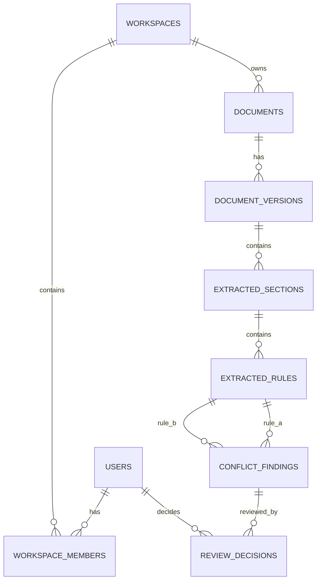

# PolicyDiff - Database Schema Specification

## 1. Overview
The database schema is designed for PostgreSQL using SQLAlchemy 2.0 ORM. It organizes policy documents into workspaces, versions, sections, extracted deontic rules, conflict detections, and compliance review decisions.

## 2. Table Definitions

### 2.1 `users`
Represents compliance analysts, policy managers, and auditors.
| Column | Type | Constraints | Description |
|---|---|---|---|
| `id` | UUID | PK, default uuid4 | Unique user ID |
| `email` | VARCHAR(255) | UNIQUE, NOT NULL | User email address |
| `full_name` | VARCHAR(255) | NOT NULL | User's full name |
| `hashed_password` | VARCHAR(255) | NOT NULL | Password hash |
| `role` | VARCHAR(50) | NOT NULL, default 'analyst' | Role (`admin`, `analyst`, `viewer`) |
| `is_active` | BOOLEAN | NOT NULL, default TRUE | Active account flag |
| `created_at` | TIMESTAMPTZ | NOT NULL, default now() | Timestamp created |
| `updated_at` | TIMESTAMPTZ | NOT NULL, default now() | Timestamp updated |

### 2.2 `workspaces`
Logical tenant boundary grouping documents, rules, and reviews (e.g., "IT Security", "HR & Employment", "Procurement").
| Column | Type | Constraints | Description |
|---|---|---|---|
| `id` | UUID | PK, default uuid4 | Unique workspace ID |
| `name` | VARCHAR(255) | NOT NULL | Workspace name |
| `slug` | VARCHAR(100) | UNIQUE, NOT NULL | URL-friendly slug |
| `description` | TEXT | NULLABLE | Detailed description |
| `created_at` | TIMESTAMPTZ | NOT NULL, default now() | Timestamp created |
| `updated_at` | TIMESTAMPTZ | NOT NULL, default now() | Timestamp updated |

### 2.3 `documents`
Represents an ongoing policy document entity that can have multiple versions over time.
| Column | Type | Constraints | Description |
|---|---|---|---|
| `id` | UUID | PK, default uuid4 | Unique document ID |
| `workspace_id` | UUID | FK -> `workspaces.id`, NOT NULL | Parent workspace |
| `title` | VARCHAR(500) | NOT NULL | Policy title |
| `category` | VARCHAR(100) | NOT NULL | Category (e.g. `Security`, `HR`, `Finance`) |
| `description` | TEXT | NULLABLE | Policy overview |
| `created_at` | TIMESTAMPTZ | NOT NULL, default now() | Creation timestamp |
| `updated_at` | TIMESTAMPTZ | NOT NULL, default now() | Last update timestamp |

### 2.4 `document_versions`
Specific revision of a document (e.g., v1.0, v2.1) uploaded as a file.
| Column | Type | Constraints | Description |
|---|---|---|---|
| `id` | UUID | PK, default uuid4 | Unique version ID |
| `document_id` | UUID | FK -> `documents.id`, NOT NULL | Parent document |
| `version_tag` | VARCHAR(50) | NOT NULL | Semantic version string (e.g. `1.0.0`, `2024-Q1`) |
| `file_name` | VARCHAR(255) | NOT NULL | Original uploaded filename |
| `file_format` | VARCHAR(20) | NOT NULL | File format (`pdf`, `docx`, `txt`) |
| `file_path` | VARCHAR(1024) | NOT NULL | Internal storage path |
| `file_size_bytes` | BIGINT | NOT NULL | File size in bytes |
| `status` | VARCHAR(50) | NOT NULL, default 'pending' | Processing status (`pending`, `parsed`, `extracted`, `failed`) |
| `effective_date` | DATE | NULLABLE | When policy became legally active |
| `uploaded_by` | UUID | FK -> `users.id`, NULLABLE | User who uploaded |
| `created_at` | TIMESTAMPTZ | NOT NULL, default now() | Upload timestamp |

### 2.5 `extracted_sections`
Structured tree of headings, paragraphs, and clauses extracted from a document version.
| Column | Type | Constraints | Description |
|---|---|---|---|
| `id` | UUID | PK, default uuid4 | Unique section ID |
| `version_id` | UUID | FK -> `document_versions.id`, NOT NULL | Target document version |
| `parent_section_id` | UUID | FK -> `extracted_sections.id`, NULLABLE | Self-referencing parent section |
| `section_number` | VARCHAR(50) | NULLABLE | E.g. "3.2.1" |
| `heading` | VARCHAR(500) | NULLABLE | Section heading text |
| `level` | INTEGER | NOT NULL, default 1 | Header hierarchy depth (1 = top-level) |
| `page_start` | INTEGER | NULLABLE | Start page in PDF |
| `page_end` | INTEGER | NULLABLE | End page in PDF |
| `raw_text` | TEXT | NOT NULL | Full section text body |
| `order_index` | INTEGER | NOT NULL | Sequence index within the document |
| `created_at` | TIMESTAMPTZ | NOT NULL, default now() | Extraction timestamp |

### 2.6 `extracted_rules`
Atomic deontic compliance statements extracted by NLP from document sections.
| Column | Type | Constraints | Description |
|---|---|---|---|
| `id` | UUID | PK, default uuid4 | Internal DB UUID |
| `rule_id` | VARCHAR(100) | NOT NULL, UNIQUE | Canonical human-readable rule ID (e.g. `SEC-V1-R042`) |
| `version_id` | UUID | FK -> `document_versions.id`, NOT NULL | Document version source |
| `section_id` | UUID | FK -> `extracted_sections.id`, NOT NULL | Section source |
| `subject` | VARCHAR(500) | NOT NULL | Who the rule governs (e.g. "Engineers", "All staff") |
| `obligation` | VARCHAR(50) | NOT NULL | Deontic modality (`MUST`, `MUST_NOT`, `SHOULD`, `MAY`, `CANNOT`) |
| `action` | VARCHAR(500) | NOT NULL | Operative action (e.g. "rotate access keys") |
| `target_object` | VARCHAR(500) | NOT NULL | Target entity (e.g. "IAM credentials", "production keys") |
| `conditions` | JSONB | NOT NULL, default '[]' | List of prerequisite conditions |
| `exceptions` | JSONB | NOT NULL, default '[]' | List of exception clauses |
| `raw_text` | TEXT | NOT NULL | Original sentence verbatim |
| `char_start` | INTEGER | NULLABLE | Character offset start in section |
| `char_end` | INTEGER | NULLABLE | Character offset end in section |
| `confidence_score` | FLOAT | NOT NULL, default 1.0 | Extraction confidence score (0.0 - 1.0) |
| `created_at` | TIMESTAMPTZ | NOT NULL, default now() | Creation timestamp |

### 2.7 `conflict_findings`
Identified discrepancy, contradiction, or gap between two rules (or one rule flagged for ambiguity).
| Column | Type | Constraints | Description |
|---|---|---|---|
| `id` | UUID | PK, default uuid4 | Unique finding ID |
| `workspace_id` | UUID | FK -> `workspaces.id`, NOT NULL | Workspace context |
| `rule_a_id` | UUID | FK -> `extracted_rules.id`, NOT NULL | Primary rule |
| `rule_b_id` | UUID | FK -> `extracted_rules.id`, NULLABLE | Conflicting rule (NULL if standalone ambiguity) |
| `category` | VARCHAR(50) | NOT NULL | Conflict type (see taxonomy) |
| `severity` | VARCHAR(20) | NOT NULL | `CRITICAL`, `HIGH`, `MEDIUM`, `LOW`, `INFO` |
| `description` | TEXT | NOT NULL | Automated explanation of why these conflict |
| `confidence` | FLOAT | NOT NULL, default 1.0 | Detection confidence (0.0 - 1.0) |
| `status` | VARCHAR(50) | NOT NULL, default 'PENDING' | Review state (`PENDING`, `RESOLVED`, `DISMISSED`) |
| `created_at` | TIMESTAMPTZ | NOT NULL, default now() | Detection timestamp |

### 2.8 `review_decisions`
Auditable human determinations on detected conflict findings.
| Column | Type | Constraints | Description |
|---|---|---|---|
| `id` | UUID | PK, default uuid4 | Unique review record ID |
| `conflict_id` | UUID | FK -> `conflict_findings.id`, NOT NULL | Associated conflict |
| `reviewer_id` | UUID | FK -> `users.id`, NOT NULL | Reviewing user |
| `decision` | VARCHAR(50) | NOT NULL | `ACCEPTED_CONFLICT`, `DISMISSED_FALSE_POSITIVE`, `RESOLVED`, `FLAGGED_FOR_LEGAL` |
| `notes` | TEXT | NULLABLE | Rationale / explanation by reviewer |
| `action_taken` | VARCHAR(255) | NULLABLE | Action taken (e.g., "Policy updated in v2.2", "Legal consulted") |
| `created_at` | TIMESTAMPTZ | NOT NULL, default now() | Decision timestamp |
